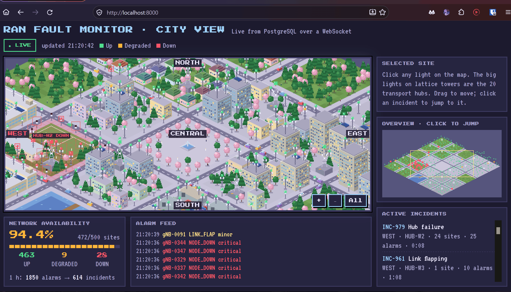
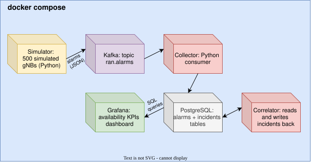

# RAN Fault Monitor

Real-time fault monitoring for a simulated 5G radio access network (RAN): 500 base stations stream alarms through Kafka, a correlator turns alarm storms into single incidents, an anomaly detector flags unstable sites, and a live pixel-art city map shows every site as it goes down.



## Run it

You need Docker. Three commands:

```bash
git clone https://github.com/marcos-rdl/ran-fault-monitor.git
cd ran-fault-monitor
docker compose up -d --build
```

Then open:

- **Live city map:** http://localhost:8000
- **Grafana dashboard:** http://localhost:3000/d/ran-overview (login `admin` / `admin`, you can skip the password change)

The first transport hub fails about a minute after start, so you will see a whole neighbourhood go red early. Stop everything with `docker compose down` (the simulator clears its open alarms before it stops).

## Architecture



| Service | What it does |
|---|---|
| `simulator` | 500 gNBs in 5 regions, 4 transport hubs per region, 25 sites per hub. Raises and clears X.733-style alarms: site outages, power failures (battery runs out, then the site drops), flapping links, high temperature, and hub failures that take down all 25 sites behind a hub at once. Five "flaky" sites fail far more often than the rest. |
| Kafka | Topic `ran.alarms`, keyed by node. |
| `collector` | Consumes alarms in batches and stores them in PostgreSQL. Offsets are committed only after the database commit, so no alarm is lost if it crashes. |
| `correlator` | Groups related alarms into incidents (rules below). |
| `detector` | Flags sites that fail far more often than the network average. |
| `mapserver` | FastAPI service: one background task reads PostgreSQL every 2 s and pushes the snapshot to every open browser over a WebSocket. |
| Grafana | Availability, alarm rate by severity, open incidents, sites down by region, flaky sites. |

## How correlation works

A single hub failure produces 26 alarms (1 `TRANSPORT_LINK_DOWN` + 25 `NODE_DOWN`). An operator should see **one** incident, not 26.

1. A `TRANSPORT_LINK_DOWN` on a hub opens a hub incident. Every `NODE_DOWN` behind that hub joins it. Site outages on that hub that started up to 30 s earlier are merged in.
2. Any other alarm joins the open incident of its site (a `NODE_DOWN` after a `POWER_FAILURE` is the same problem), otherwise it opens a new one.
3. A clear joins the incident of the alarm it clears.
4. An incident closes when all its alarms are cleared and nothing new has arrived for 60 s, so a flapping link stays one incident instead of ten.

## How anomaly detection works

Every 30 s the detector counts each site's faults over the last 60 minutes, and computes a z-score against all 500 sites. A site is flagged when z ≥ 3.5 and it has at least 5 faults. It counts faults, not incidents (the correlator's hold-down merges back-to-back failures, which would hide a flaky site), and a burst of link flaps counts once. In test runs it found the five flaky sites in about 20 minutes, with no false positives over six simulated hours.

## The city map

Each of the 20 hubs is a neighbourhood with exactly 25 masts: rooftop sites, standalone masts and small cells on street poles, named and numbered exactly like the simulator's gNBs. Click any light for its alarms and incident, click an incident to fly to it, or use the overview to move around. Every building, tree and car is drawn in code on a canvas, so there are no third-party assets.

## Project structure

```
simulator/    alarm generator (Kafka producer)
collector/    Kafka to PostgreSQL
correlator/   alarms to incidents
detector/     flaky-site detection
mapserver/    FastAPI + WebSocket service, and the map page in static/
grafana/      provisioned data source and dashboard
docs/         architecture diagram and demo GIF
Dockerfile    one image recipe for all five Python services
```

## Running a service outside Docker

Every service reads `KAFKA` and `DB` from the environment and falls back to `localhost`, so you can run one from your terminal while the rest stay in Docker:

```bash
docker compose stop correlator
cd correlator
python3 -m venv .venv && source .venv/bin/activate
pip install -r requirements.txt
python correlator.py
```

## Tech

Python 3.12, Kafka 3.8 (KRaft, no ZooKeeper), PostgreSQL 16, psycopg 3, FastAPI, WebSockets, Grafana 11, Docker Compose, HTML canvas.

## What I would add next

- Deduplication on a message key, to make the at-least-once delivery exactly-once in effect
- Alarm acknowledgement and incident assignment from the map
- A second Kafka broker and replication

---

Personal project. All code and data are written from scratch and fully simulated.
